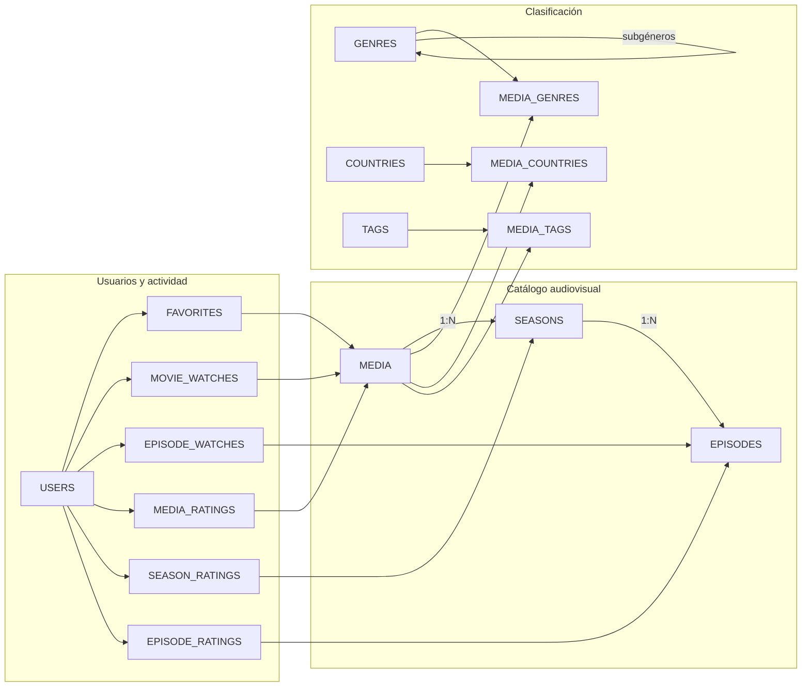

# Modelo entidad-relación

El modelo se divide visualmente en tres bloques: **usuarios y actividad**, **catálogo audiovisual** y **clasificación**. Las tablas intermedias representan relaciones N:M.

## Relaciones principales

- `USERS` y `MEDIA` se relacionan N:M mediante `FAVORITES`, `MOVIE_WATCHES` y `MEDIA_RATINGS`.
- Las series se estructuran como `MEDIA → SEASONS → EPISODES`.
- El seguimiento de episodios se registra en `EPISODE_WATCHES`.
- Las valoraciones pueden realizarse sobre contenido, temporadas y episodios.
- Géneros, países y etiquetas se relacionan con `MEDIA` mediante tablas intermedias.
- `GENRES` utiliza una relación autorreferenciada para permitir subgéneros.
